# Post-contenido — Unidad 9: Seguridad en Aplicaciones Web

## Descripción

Repositorio del laboratorio de la Unidad 9 de Programación Web — Séptimo
Semestre. Contiene un único proyecto Maven Spring Boot (`seguridad-web/`,
paquete `com.universidad.seguridad`) con **dos mecanismos de autenticación
coexistiendo**: sesión (form-login de Spring Security) para las vistas
Thymeleaf y **JWT stateless** para la API REST bajo `/api/**`. El dominio es
deliberadamente pequeño (`Usuario` con rol ADMIN/USER y `Tarea` con
propietario) para que la evidencia se concentre en la capa de seguridad.

**Estudiante:** Neidys Mariana Quintero Carrillo

## Tecnologías

Spring Boot 3.2, Spring Security 6 (form-login, `BCryptPasswordEncoder`,
`@EnableMethodSecurity`/`@PreAuthorize`, dos `SecurityFilterChain`), Spring
Data JPA + MySQL 8, Thymeleaf + `thymeleaf-extras-springsecurity6`, jjwt
0.12.5, Java 17, Maven.

## Estructura (capas)

```
quintero-post1-u9/
├── README.md
├── docker-compose.yml                 ← MySQL 8 con seguridad_db (opcional)
├── scripts/probar-jwt.sh              ← flujo JWT completo + prueba CSRF con curl
├── capturas/  parte-1/  parte-2/
└── seguridad-web/
    ├── pom.xml
    └── src/main/java/com/universidad/seguridad/
        ├── config/      SecurityConfig.java (webFilterChain @Order(2) + apiFilterChain @Order(1)),
        │                AdminInicializador.java
        ├── model/       Usuario.java, Tarea.java
        ├── repository/  UsuarioRepository.java, TareaRepository.java (@Query parametrizado)
        ├── service/     UsuarioService.java, TareaService.java (@PreAuthorize), CorreoDuplicadoException.java
        ├── security/    UsuarioDetailsService.java, JwtUtil.java, JwtAuthFilter.java
        ├── dto/         TareaDto.java
        └── controller/  AuthController.java, TareaController.java   (vistas, sesión)
                         ApiAuthController.java, ApiTareaController.java (API, JWT)
```

## Parte 1 — Login con sesión, BCrypt, roles y mitigación activa

`webFilterChain` (`@Order(2)`, `securityMatcher("/**")`) configura form-login
en `/login`, logout por POST en `/logout`, `/admin/**` solo para `ROLE_ADMIN`
y el resto autenticado. `UsuarioDetailsService` carga el usuario desde MySQL y
`BCryptPasswordEncoder(12)` verifica la contraseña (los hashes empiezan por
`$2a$12$`). El registro asigna siempre `ROLE_USER` en el servidor (aunque se
envíe `rol` en el formulario). Los servicios agregan una segunda barrera con
`@PreAuthorize` (`hasRole('ADMIN')`, o "solo mis tareas" con
`#email == authentication.name`). El usuario ADMIN inicial lo crea
`AdminInicializador` al arrancar, con la contraseña tomada de la variable de
entorno `ADMIN_PASSWORD`.

### Verificación de XSS (th:text vs. th:utext)

Se registró un usuario cuyo **nombre** es `<script>alert("XSS")</script>`.

- **Con `th:text`** (versión que queda en el repositorio): Thymeleaf escapa el
  valor (`&lt;script&gt;…`) y el dashboard muestra el texto literal; el
  script **no** se ejecuta.
- **Con `th:utext`** (línea comentada en `dashboard.html`, activada solo para
  la prueba y luego revertida): el valor se inserta como HTML y el navegador
  **sí** ejecuta la alerta.

Todas las vistas muestran datos de usuario con `th:text`.

### Verificación de SQL Injection (@Query parametrizado)

El buscador del dashboard envía el texto a
`TareaRepository.buscarPorTitulo`, un `@Query` JPQL con parámetros nombrados
(`:email`, `:texto`). Al buscar `' OR '1'='1` la consulta **no devuelve
nada**: el texto viaja como dato de un `PreparedStatement` y se compara
literalmente con el título. Con la versión concatenada (documentada solo en
comentario en el repositorio), la consulta habría quedado
`... WHERE titulo LIKE '%' OR '1'='1%'`, una condición siempre verdadera que
devuelve **todas las tareas de todos los usuarios**, ignorando el filtro.

### Verificación de CSRF

CSRF está activo en `webFilterChain`. Un `POST /logout` sin token
(`curl -i -X POST http://localhost:8080/logout`) responde **403 Forbidden**;
el botón "Cerrar Sesión" del dashboard sí funciona porque `th:action` agrega
el campo oculto `_csrf` automáticamente, y redirige a `/login?logout`.

## Parte 2 — API REST stateless protegida con JWT

`apiFilterChain` (`@Order(1)`, `securityMatcher("/api/**")`) es
`SessionCreationPolicy.STATELESS`, desactiva CSRF solo en esta cadena,
permite `POST /api/auth/login`, exige `ROLE_ADMIN` en `/api/admin/**`,
autenticación en el resto, y responde **401** (no 403) cuando no hay token
válido. `JwtUtil` genera y valida tokens firmados con HMAC-SHA256 y
expiración de 1 hora; `JwtAuthFilter` (`OncePerRequestFilter`) lee
`Authorization: Bearer …` en cada petición y puebla el `SecurityContext`
con el correo y el rol del token, sin consultar la base de datos. El filtro
se registra solo dentro de `apiFilterChain` (se desactivó su registro global
como filtro de servlet).

| Método | Ruta                 | Acceso                | Respuesta |
|--------|----------------------|-----------------------|-----------|
| POST   | `/api/auth/login`    | público               | 200 `{token, email, rol}` · 401 si las credenciales fallan |
| GET    | `/api/tareas`        | token válido          | 200 con las tareas del dueño del token · 401 sin token o con token alterado/expirado |
| GET    | `/api/admin/tareas`  | token con `ROLE_ADMIN`| 200 con todas las tareas · 403 con token de USER |

La API devuelve `TareaDto` y no la entidad, para no exponer el `Usuario`
propietario (con su hash de contraseña).

## Por qué dos mecanismos en el mismo proyecto

Las vistas Thymeleaf sirven a un **navegador con cookie de sesión**: es el
mecanismo natural para una aplicación web tradicional y por eso CSRF debe
seguir activo ahí (el navegador adjunta la cookie a cualquier petición,
incluso una provocada por otro sitio). La API sirve a **clientes sin cookies**
(una app móvil, un frontend SPA en otro dominio, la integración de un
tercero): necesitan una credencial autocontenida en cada petición, que no
dependa de estado en el servidor. Un JWT en el header `Authorization` resuelve
ese caso, y como un formulario de otro sitio no puede fijar ese header, CSRF
no aplica. Ningún mecanismo reemplaza al otro: cada uno cubre un tipo de
cliente distinto, y ambos funcionan **al mismo tiempo** sobre el mismo
`AuthenticationManager`, `UserDetailsService` y `BCryptPasswordEncoder`.

## Decisiones de diseño

- **Dominio pequeño (Usuario + Tarea)**: la unidad evalúa seguridad, no
  modelado; menos pantallas concentran la evidencia de las pruebas.
- **`securityMatcher` + `@Order` explícitos en las dos cadenas**: Spring
  Security usa la primera cadena cuyo matcher coincide. Con `/api/**` en
  `@Order(1)` y `/**` en `@Order(2)`, una petición a la API nunca cae en el
  form-login (que respondería con un redirect HTML en vez de un 401).
- **CSRF desactivado solo en `apiFilterChain`**: esa cadena no crea ni lee
  `HttpSession` (`STATELESS`), así que no hay cookie que explotar.
- **El filtro JWT no lanza excepciones**: si el token falta o es inválido,
  solo deja de autenticar; la decisión de aceptar o rechazar queda en
  `authorizeHttpRequests`, el único lugar con las reglas por ruta.
- **401 con `HttpStatusEntryPoint`**: sin form-login ni Basic, Spring
  Security respondería 403 a una petición anónima; 401 es el código correcto
  para "no autenticado".
- **Clave JWT y contraseña del ADMIN fuera del código**: se leen de
  `application.properties`, que a su vez las toma de las variables de entorno
  `JWT_SECRET` y `ADMIN_PASSWORD`. Los valores por defecto existen solo para
  que el laboratorio arranque sin configuración; en producción se deben
  definir las variables (o un gestor de secretos), porque quien conozca la
  clave puede firmar tokens válidos.
- **`@PreAuthorize` con `authentication.name`**: el correo es el `name` tanto
  con sesión como con JWT, así la misma regla protege a las dos superficies.
- **Defensa contra asignación masiva**: `rol` y `activo` los fija
  `UsuarioService.registrar`, nunca el formulario.

## Configuración y ejecución

1. Clonar: `git clone https://github.com/neidys06/quintero-post1-u9.git`
2. Base de datos: `docker compose up -d` (crea `seguridad_db` y
   `appuser`/`apppass`) o, en MySQL instalado:
   ```sql
   CREATE DATABASE seguridad_db CHARACTER SET utf8mb4 COLLATE utf8mb4_unicode_ci;
   CREATE USER "appuser"@"localhost" IDENTIFIED BY "apppass";
   GRANT ALL PRIVILEGES ON seguridad_db.* TO "appuser"@"localhost";
   ```
3. (Recomendado) definir los secretos:
   `export JWT_SECRET="una-clave-larga-de-al-menos-32-caracteres"` y
   `export ADMIN_PASSWORD="admin123"` (en PowerShell: `$env:JWT_SECRET="..."`).
4. `cd seguridad-web` y `mvn spring-boot:run`. Al primer arranque se crea
   `admin@universidad.edu` con rol `ROLE_ADMIN`.
5. Vistas: http://localhost:8080/login — API: `bash scripts/probar-jwt.sh`
   (desde la raíz, en Git Bash) o Postman.

## Capturas de pantalla

### Parte 1 — Sesión

**Sin sesión, `/dashboard` redirige a `/login`**
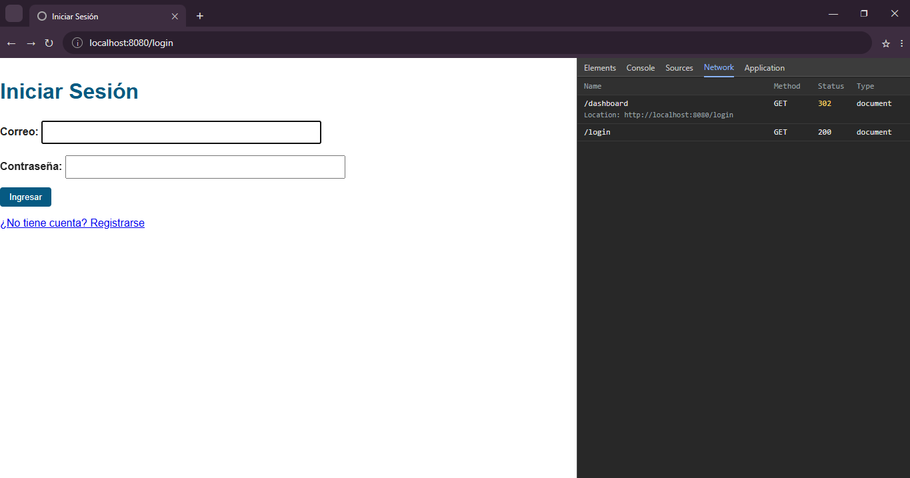

**Contraseña guardada como hash BCrypt (`$2a$12$…`) en MySQL**
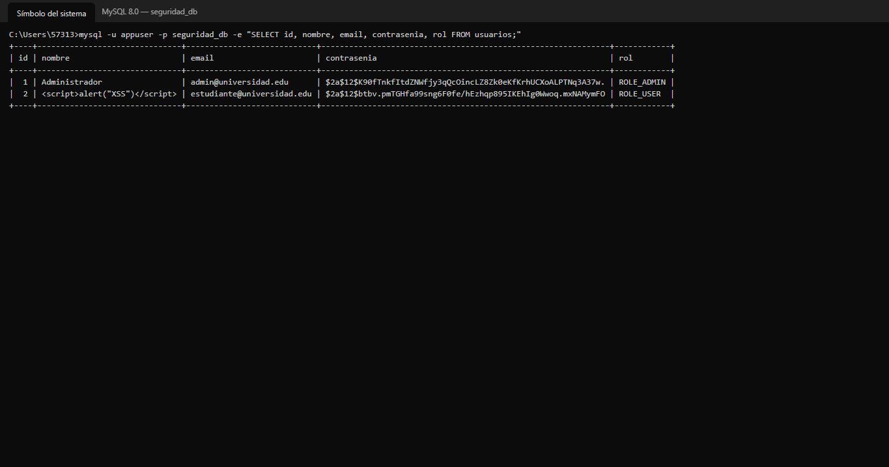

**Dashboard del USER: el payload XSS se muestra como texto con `th:text`**
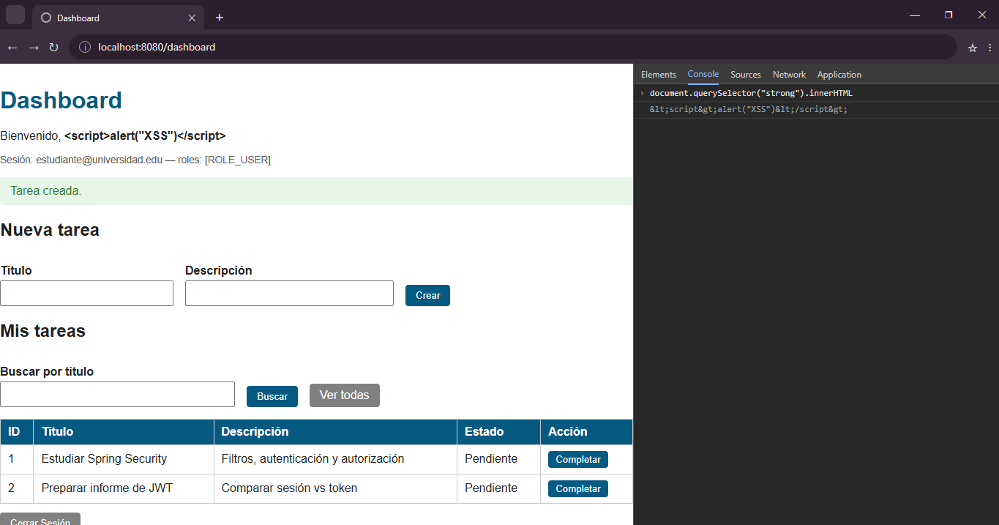

**Prueba temporal con `th:utext`: el script SÍ se ejecuta (luego revertido)**
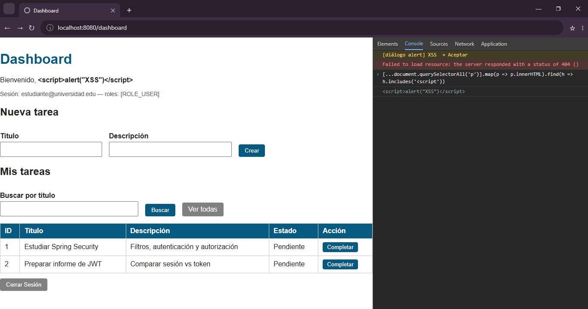

**USER intentando `/admin`: 403**
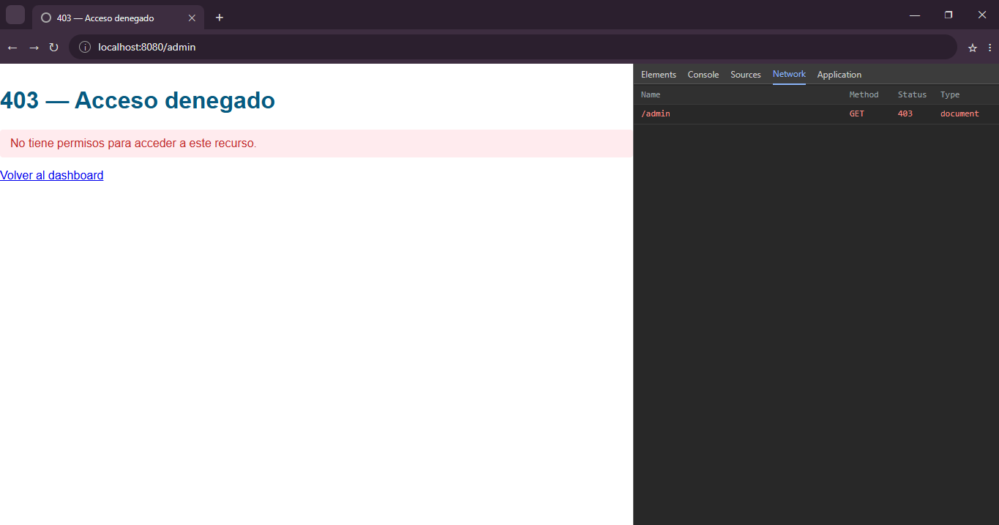

**ADMIN: panel con la lista de usuarios**
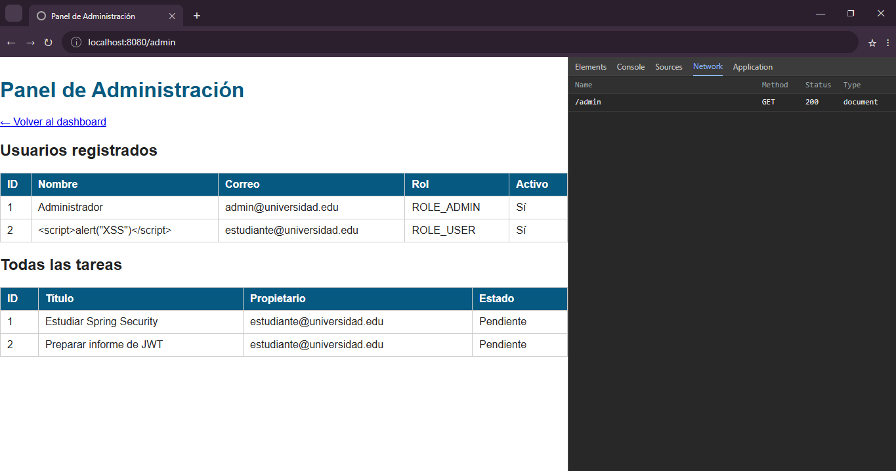

**Búsqueda `' OR '1'='1` con `@Query` parametrizado: 0 resultados**
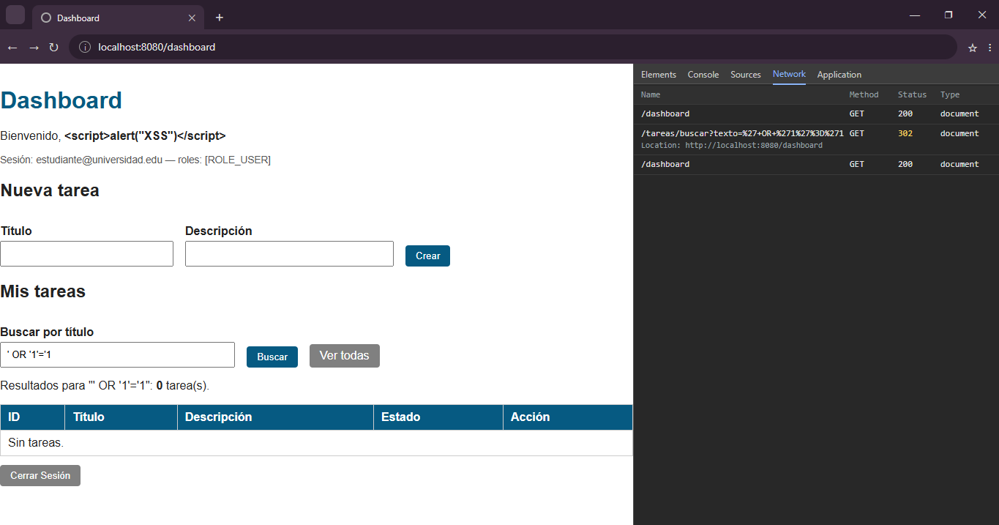

**`POST /logout` sin token CSRF: 403 Forbidden**
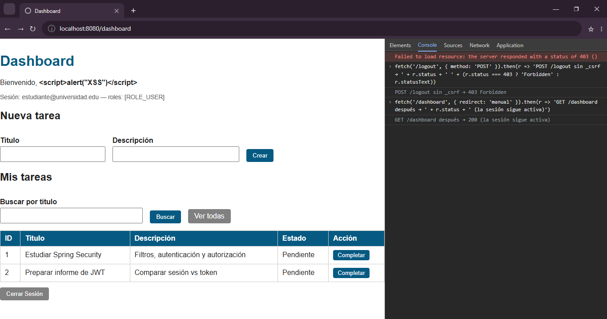

**Logout normal desde el botón (con token): `/login?logout`**
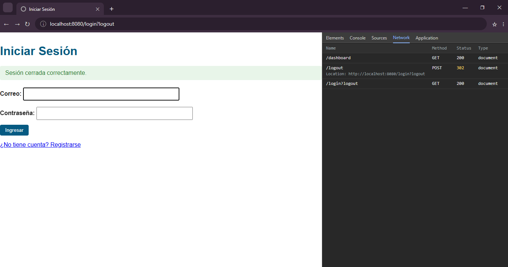

### Parte 2 — JWT

**`POST /api/auth/login` con credenciales válidas: token recibido**
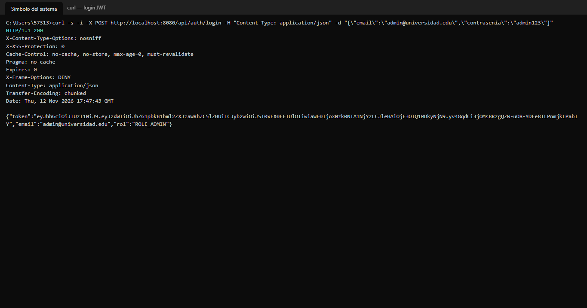

**Login con contraseña incorrecta: 401 sin token**
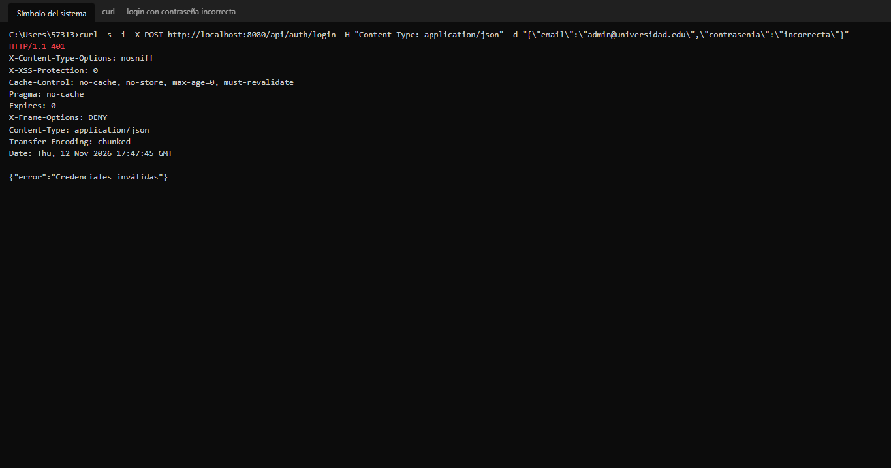

**`GET /api/tareas` con `Authorization: Bearer`: 200**
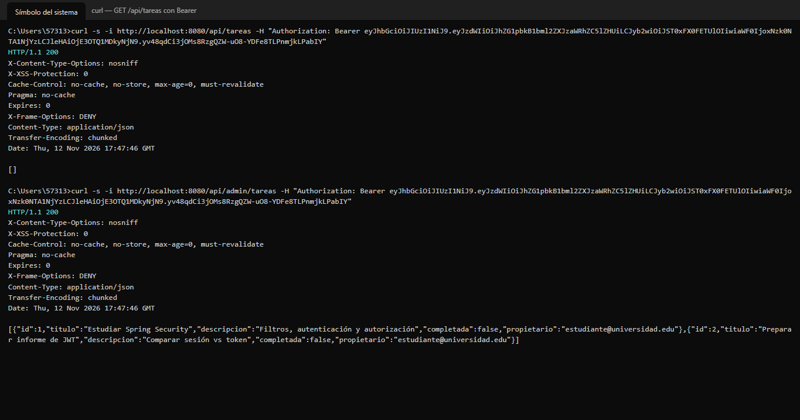

**`GET /api/tareas` sin token: 401**
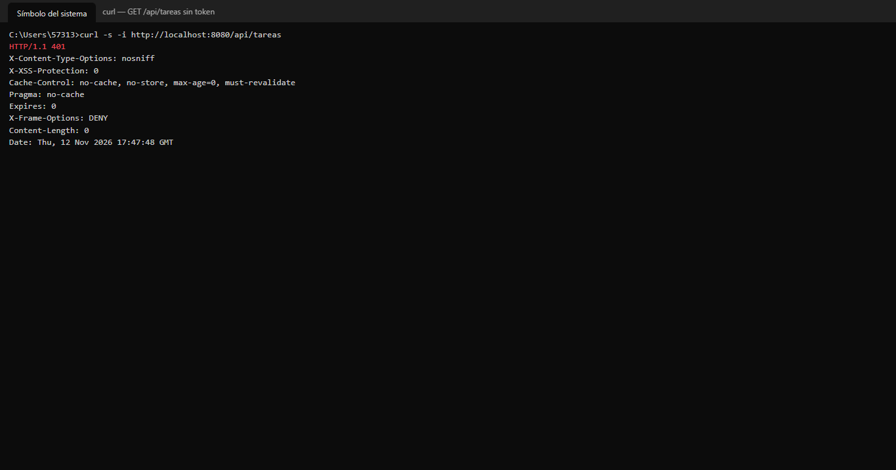

**`GET /api/tareas` con la firma alterada: 401**
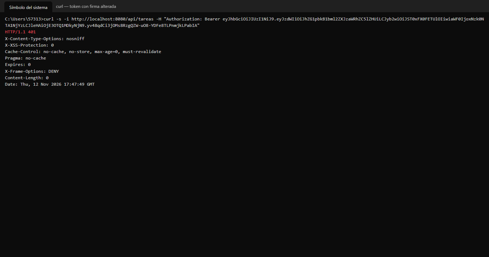

**Dashboard con sesión abierto mientras la API responde con JWT (coexistencia)**
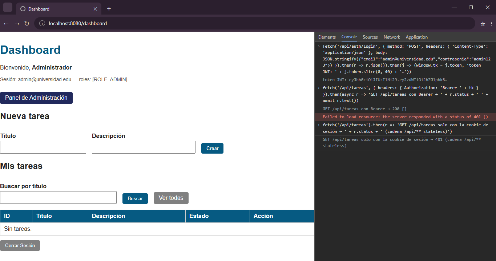
